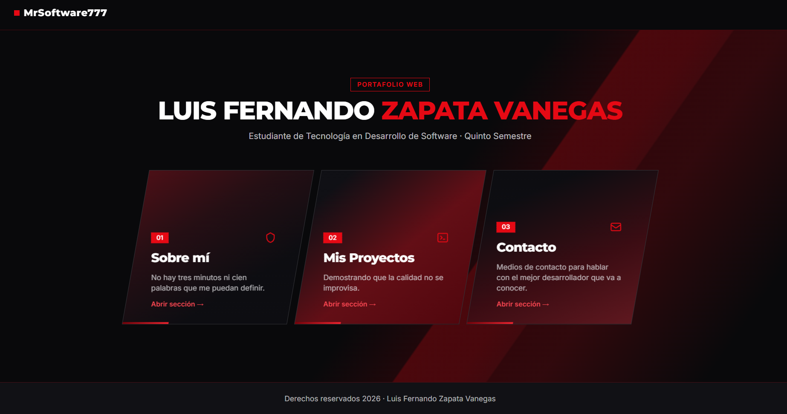
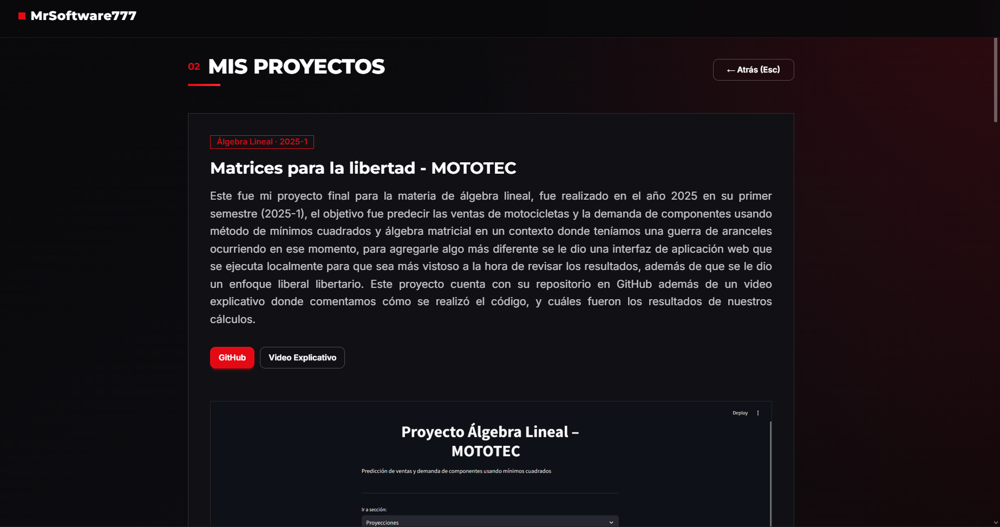

# Portafolio Web — Luis Fernando Zapata Vanegas

Portafolio personal modernizado con **HTML5**, **CSS3**, **Tailwind CSS v4** y **daisyUI v5** para la asignatura de Programación Web (Tecnología en Desarrollo de Software — UTP).

## Diseño

- **Paleta y tema:** Tema oscuro personalizado (`crimson-dark`) en negro profundo, rojo vibrante y blanco.
- **Tipografía:** `Montserrat` para títulos y `Inter` para el contenido.
- **Navegación:** Pantalla inicial con tres paneles inclinados (*Sobre mí*, *Mis Proyectos* y *Contacto*) que abren cada sección a pantalla completa con transición de zoom, y cierre con el botón de regreso o la tecla `Esc`.
- **Componentes:** Uso de componentes de daisyUI (`navbar`, `badge`, `card`, `btn`, `footer`) complementados con estilos propios en `style.css`.

## Vista previa





## Uso

El archivo `output.css` ya está compilado, por lo que basta con abrir `index.html` directamente en el navegador.

Si se desea recompilar los estilos tras editar `input.css` o `index.html`:

```bash
npm install
npm run build:css
```

## Licencia

Este proyecto está bajo la [Licencia MIT](./LICENSE).
